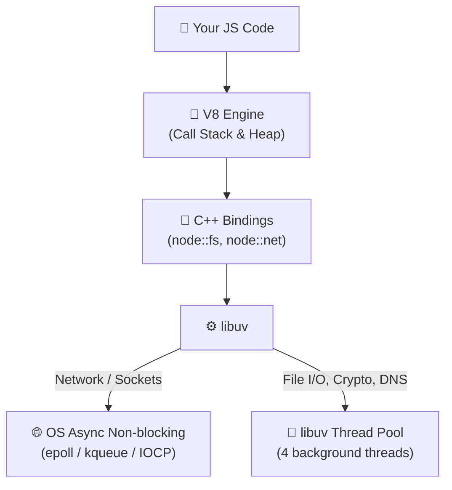
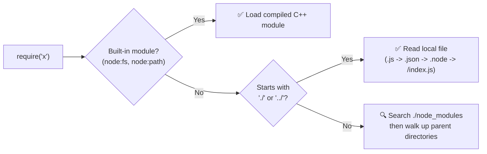
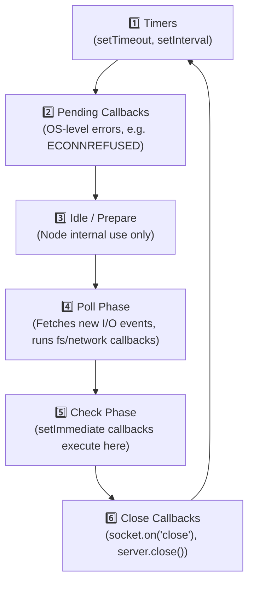
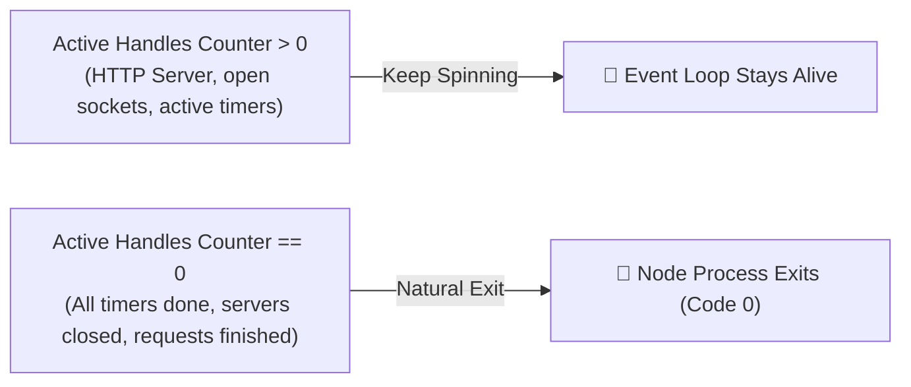
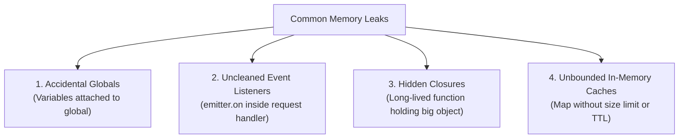
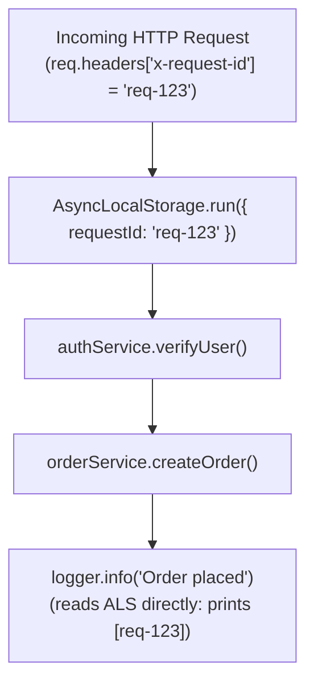
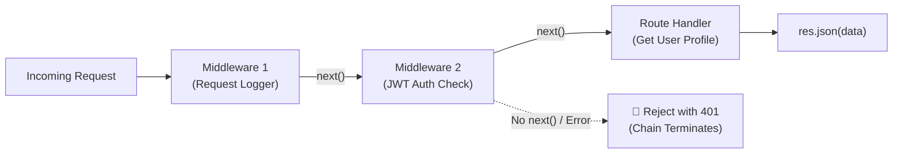
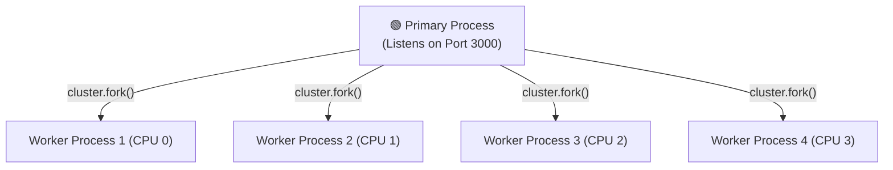
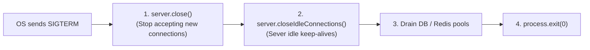
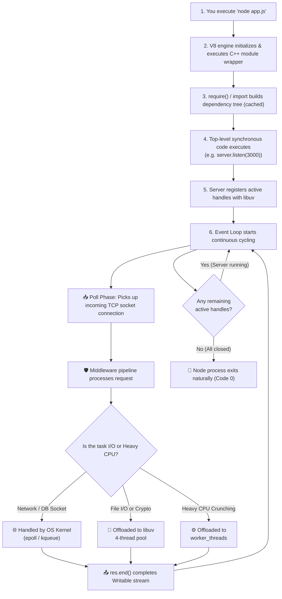

# 🟢 Node.js Internals & Interview Master Guide
### *The Story of What Actually Happens Inside Your Server*

> **How to use this guide:** Read this like an interactive mental map. Each section gives you:
> 1. 💡 **The Mental Model** (1-sentence real-world analogy so it clicks instantly)
> 2. 🖼️ **Short Visual Diagrams** (bite-sized, easy to sketch on a whiteboard)
> 3. ⚙️ **The Deep-Dive Mechanism** (what C++, V8, and libuv actually do)
> 4. 🎯 **Interview Traps & Senior Answers** (what interviewers wait to hear)

---

## 📑 Table of Contents
1. [🏭 Architecture: V8, libuv & The OS](#1--architecture-v8-libuv--the-os)
2. [🌍 Globals: What Exists Without Browser APIs](#2--globals-what-exists-without-browser-apis)
3. [📦 Modules: CommonJS vs ESM Internals](#3--modules-commonjs-vs-esm-internals)
4. [🔄 The Event Loop: All 6 Phases & Priority Queues](#4--the-event-loop-all-6-phases--priority-queues)
5. [🚦 Active Handles: Why Node Stays Alive (`ref` vs `unref`)](#5--active-handles-why-node-stays-alive-ref-vs-unref)
6. [🧵 libuv Thread Pool & The Starvation Trap](#6--libuv-thread-pool--the-starvation-trap)
7. [🌊 Streams & Backpressure: Handling Massive Data](#7--streams--backpressure-handling-massive-data)
8. [📢 Events & `EventEmitter` Internals](#8--events--eventemitter-internals)
9. [🗄️ Buffers: Raw Binary Data Outside V8](#9--buffers-raw-binary-data-outside-v8)
10. [🧠 Memory Management, V8 Heap & Leak Hunting](#10--memory-management-v8-heap--leak-hunting)
11. [🏷️ `AsyncLocalStorage`: Context Propagation](#11--asynclocalstorage-context-propagation)
12. [📁 The `fs` Module & Safe Path Resolution](#12--the-fs-module--safe-path-resolution)
13. [🌐 Sockets & The `http` Module Internals](#13--sockets--the-http-module-internals)
14. [🛡️ The Middleware Pipeline Pattern](#14--the-middleware-pipeline-pattern)
15. [🔀 Scaling: Child Processes, Cluster & Worker Threads](#15--scaling-child-processes-cluster--worker-threads)
16. [🚨 Error Handling & Production Graceful Shutdown](#16--error-handling--production-graceful-shutdown)
17. [📦 npm, `package.json` & SemVer Mechanics](#17--npm-packagejson--semver-mechanics)
18. [🔐 Environment Variables & Modern Config](#18--environment-variables--modern-config)
19. [🆚 Node.js vs Browser JavaScript](#19--nodejs-vs-browser-javascript)
20. [🧰 Modern Built-ins & Diagnostics](#20--modern-built-ins--diagnostics)
21. [🔧 Implement From Scratch (Live Coding Classics)](#21--implement-from-scratch-live-coding-classics)
22. [🔒 Security Quick Hits](#22--security-quick-hits)
23. [🗺️ The Complete Lifecycle: One Glance](#23--the-complete-lifecycle-one-glance)

---

## 1. 🏭 Architecture: V8, libuv & The OS

💡 **Mental Model:** **V8 is the Brain** (reads and calculates JavaScript), **libuv is the Hands & Feet** (talks to disk, network cards, and handles async waiting), and **C++ Bindings are the Nervous System** connecting them.

### Short Architecture Diagram
```
Your JS Code
     ↓
  V8 Engine (Compiles JS to Machine Code, runs Call Stack)
     ↓
 Node.js C++ Bindings (fs, net, crypto, zlib)
     ↓
   libuv (Event Loop + 4-Thread Pool + OS Event Demultiplexer)
     ↓
 Operating System Kernel (epoll on Linux / kqueue on macOS / IOCP on Windows)
```



### 🎯 The #1 Interview Question: "Is Node.js Single-Threaded?"
* **Your JavaScript execution is strictly single-threaded:** One Call Stack, one memory heap managed by V8.
* **The Node.js runtime as a whole is multi-threaded:** libuv maintains a background pool (default: 4 threads) for heavy operations (file reads, password hashing, compression), while network sockets ride OS non-blocking kernel events.
* **You can also spin up explicit JS threads** using the built-in `worker_threads` module.

---

## 2. 🌍 Globals: What Exists Without Browser APIs

💡 **Mental Model:** In a browser, `window` represents the open browser tab. In Node, `global` (or `globalThis`) represents the whole Node runtime process.

| Scope | Browser | Node.js | Notes |
|---|---|---|---|
| **Root Object** | `window` | `global` or `globalThis` | Prefer `globalThis` for cross-platform code |
| **DOM** | `document` | ❌ None | There is no HTML, canvas, or DOM tree |
| **Process State** | ❌ None | `process` | PID, env vars, memory usage, CLI args |
| **Binary Memory** | `ArrayBuffer` | `Buffer` (subclass of `Uint8Array`) | Fast byte manipulation allocated off-heap |
| **Path Helpers** | ❌ None | `__dirname`, `__filename` | **CommonJS only** (not real globals!) |
| **Module Tools** | `import` | `require`, `module`, `exports` | CommonJS only |
| **Standard Web APIs**| `fetch`, `URL` | `fetch`, `URL`, `AbortController` | Now native in modern Node |

### 🚨 The "Fake Global" Gotcha
`__dirname`, `__filename`, `require`, and `module` feel global because they exist in every file, but they are actually **local parameters injected by Node's module wrapper** (see Section 3). In ES Modules (`"type": "module"`), they do not exist!

```js
// ESM alternative (Node 20.11+):
console.log(import.meta.dirname);
console.log(import.meta.filename);
```

---

## 3. 📦 Modules: CommonJS vs ESM Internals

💡 **Mental Model:** **CommonJS is synchronous delivery** (pauses everything while unpacking the box). **ESM is asynchronous pre-ordering** (builds a dependency graph before touching any file).

### How CommonJS Actually Works: The Invisible Wrapper
When you run `node app.js`, Node silently wraps your entire file inside an invisible C++ wrapper function:

```js
(function(exports, require, module, __filename, __dirname) {
  // 👈 Your file code runs right here!
});
```
This is why `require` and `__dirname` exist without importing them — they are regular function arguments.

### The `require('x')` Resolution Algorithm


### Module Caching (`require.cache`)
`require('./db')` executes that file **only once**. The evaluated `module.exports` is stored inside `require.cache`. Every future `require('./db')` across your server receives the exact same cached reference in memory.

### `exports` vs `module.exports`
* `exports` is simply an alias variable pointing to `module.exports`.
* `exports.foo = 1;` ✅ Works because you mutate the target object.
* `exports = { foo: 1 };` ❌ **Breaks!** You only reassigned your local pointer; `module.exports` remains empty.

### CommonJS vs ES Modules Cheat Sheet

| Feature | CommonJS (`require`) | ES Modules (`import`) |
|---|---|---|
| **Loading** | Synchronous | Asynchronous (parse, instantiate, evaluate) |
| **Evaluation** | Dynamic at runtime (`if (true) require(...)`) | Static analysis (enables tree-shaking) |
| **Top-level `await`** | ❌ (throws SyntaxError) | ✅ Allowed |
| **Binding Type** | **Value copy** at require time | **Live binding** (reactive view of exporter state) |
| **`this` at top level** | `module.exports` (`{}`) | `undefined` |

### Circular Dependencies: What Happens?
```
File A requires B ──→ File B requires A
```
* **In CommonJS:** Node returns a **partially evaluated (incomplete)** copy of `A` to `B` to avoid an infinite loop. This often leads to silent `undefined is not a function` errors.
* **In ESM:** Variables are hoisted with Temporal Dead Zone (TDZ). If `B` tries to read an uninitialized `const`/`let` export from `A`, it loudly throws a `ReferenceError` (much easier to fix).

---

## 4. 🔄 The Event Loop: All 6 Phases & Priority Queues

💡 **Mental Model:** A train continuously cycling through 6 stations. At **every stop between callbacks**, the train conductor clears out two VIP waiting lines (`process.nextTick` and `Promise microtasks`) before moving to the next passenger.

### The 6 Loop Phases


### The VIP Queues (Run Between Every Single Callback)
Whenever any JavaScript callback finishes execution, Node drains these microtask queues before continuing:

```
[Current Callback Finished]
            ↓
  1. Drain process.nextTick Queue (Highest Priority VIP)
            ↓
  2. Drain Promise Microtask Queue (.then, .catch, await)
            ↓
[Proceed to next callback or next Event Loop phase]
```

### 🎯 The Classic Interview Execution Trace
```js
console.log("1. Sync");

setTimeout(() => console.log("2. Timer (setTimeout)"), 0);
setImmediate(() => console.log("3. Immediate (setImmediate)"));
process.nextTick(() => console.log("4. nextTick"));
Promise.resolve().then(() => console.log("5. Promise microtask"));

console.log("6. Sync End");
```
**Output Order:**
1. `1. Sync`
2. `6. Sync End`
3. `4. nextTick` *(highest priority queue)*
4. `5. Promise microtask` *(Promise queue)*
5. `2. Timer` or `3. Immediate` *(At file root, non-deterministic: depends on CPU speed whether 1ms timer expired before loop started).*

### ⚡ The Poll Phase Trap: Why `setImmediate` Wins Inside I/O
When inside an I/O callback (like `fs.readFile`), the order is **100% deterministic**:

```js
const fs = require('node:fs');

fs.readFile(__filename, () => {
  setTimeout(() => console.log('timeout'), 0);
  setImmediate(() => console.log('immediate'));
});
// ALWAYS prints:
// 1. immediate
// 2. timeout
```
**Why?** The file read callback finishes inside the **Poll phase**. Looking at the loop order: the very next phase is **Check** (`setImmediate`). The **Timers** phase cannot run until the entire loop wraps around again!

---

## 5. 🚦 Active Handles: Why Node Stays Alive (`ref` vs `unref`)

💡 **Mental Model:** **Active Handles are hotel room keys.** Node keeps the reception desk open as long as at least 1 guest holds an active room key. When the key counter hits zero, the hotel shuts off all lights and closes.



### The `unref()` Escape Hatch
By default, every `setInterval` or `net.Socket` registers an active handle that prevents your Node process from ever exiting.
Calling `.unref()` tells libuv: *"Do not count this handle toward keeping the process alive."*

```js
// Background heartbeat metric:
const timer = setInterval(() => {
  sendHealthMetrics();
}, 5000);

// If main server closes, don't let this timer hang the process!
timer.unref(); 

// timer.ref() re-activates process-holding behavior
```

---

## 6. 🧵 libuv Thread Pool & The Starvation Trap

💡 **Mental Model:** **OS Kernel Async is a self-checkout counter** (thousands can scan in parallel). **The libuv Thread Pool is a staffed counter with only 4 cashiers** (if 4 customers order complex tasks, the 5th customer waits in line).

### Who Uses What?
```
┌───────────────────────────────────────────────┐
│              libuv Architecture               │
├───────────────────────┬───────────────────────┤
│ OS Kernel Non-blocking│ libuv Thread Pool     │
│ (epoll / kqueue / IOCP)│ (Default: 4 Threads)  │
├───────────────────────┼───────────────────────┤
│ • TCP / HTTP Sockets  │ • All `fs.*` calls    │
│ • UDP Connections     │ • `crypto.pbkdf2`     │
│ • Incoming Webhooks   │ • `crypto.scrypt`     │
│ • Outgoing fetch()    │ • `zlib` compression  │
│                       │ • `dns.lookup()`      │
└───────────────────────┴───────────────────────┘
```

### 🚨 The Thread Pool Starvation Disaster
Imagine running 4 password hashes simultaneously on your server:

```js
const crypto = require('node:crypto');
const fs = require('node:fs');

// Occupies all 4 libuv threads simultaneously:
for (let i = 0; i < 4; i++) {
  crypto.pbkdf2('pass', 'salt', 1000000, 64, 'sha512', () => {
    console.log(`Hash ${i} done`);
  });
}

// ⚠️ BLOCKED! This simple 1KB read cannot run until one hash finishes!
fs.readFile('small.txt', () => console.log('File read finished'));
```

### 🛠️ The Fix: Set `UV_THREADPOOL_SIZE`
Increase the pool size **before** starting Node (up to max 128 threads):
```bash
# In your Dockerfile or launch script:
UV_THREADPOOL_SIZE=8 node server.js
```

---

## 7. 🌊 Streams & Backpressure: Handling Massive Data

💡 **Mental Model:** Drinking from a garden hose instead of filling an Olympic-sized swimming pool in RAM before taking a sip.

### The 4 Types of Streams
| Type | Flow | Real-world Example |
|---|---|---|
| **Readable** | Source → Out | `fs.createReadStream()`, incoming `req` |
| **Writable** | In → Destination | `fs.createWriteStream()`, outgoing `res` |
| **Duplex** | In & Out (Independent) | `net.Socket` (bidirectional TCP connection) |
| **Transform** | In → Modified → Out | `zlib.createGzip()`, `crypto.createCipheriv()` |

### Backpressure Visualized
When the producer is faster than the consumer, memory will explode unless backpressure pauses the producer:


### ❌ Never Use `.pipe()` in Production — Use `pipeline()`!
* `.pipe()` handles flow control, but **does not forward errors** or clean up open file descriptors if the stream breaks midway.
* `pipeline()` from `node:stream/promises` handles auto-cleanup, error handling, and `async/await`:

```js
const { pipeline } = require('node:stream/promises');
const fs = require('node:fs');
const zlib = require('node:zlib');

try {
  await pipeline(
    fs.createReadStream('input.csv'),
    zlib.createGzip(),
    fs.createWriteStream('input.csv.gz')
  );
  console.log('Compression complete with zero memory bloat');
} catch (err) {
  // If ANY step fails, ALL streams are immediately destroyed!
  console.error('Pipeline failed cleanly:', err);
}
```

---

## 8. 📢 Events & `EventEmitter` Internals

💡 **Mental Model:** A radio broadcast station. The host speaks into the mic (`emit`), and every tuned-in radio (`on`) plays the sound **synchronously in order**.

### 3 Rules Every Senior Dev Must Know:
1. **`emit()` is 100% synchronous:** All listeners execute immediately on the call stack before `emit()` returns.
2. **Unhandled `'error'` crashes the process:** If an emitter triggers `.emit('error', err)` and no listener is attached for `'error'`, Node throws an uncaught exception and kills the process!
3. **The 10-listener warning:** If you register >10 listeners for a single event, Node prints a `MaxListenersExceededWarning`. This almost always means you added an `.on()` listener inside an HTTP route handler without removing it!

---

## 9. 🗄️ Buffers: Raw Binary Data Outside V8

💡 **Mental Model:** A raw block of C++ memory allocated outside the V8 JavaScript garbage collector heap, holding raw bytes (0 to 255).

```
   V8 Managed Heap            Off-Heap Native Memory (RAM)
┌──────────────────────┐     ┌───────────────────────────────┐
│ JS Objects, Strings, │     │ Buffer Memory                 │
│ Numbers, Arrays      │────>│ [ 0x48, 0x65, 0x6C, 0x6C, ... ]│
│                      │     │ (Images, Network Packets)     │
└──────────────────────┘     └───────────────────────────────┘
```

### Allocation Methods
```js
// 1. Safe Allocation (clears memory with zeros):
const safe = Buffer.alloc(1024);

// 2. Unsafe Allocation (FAST, but leaves old garbage memory intact!):
// ⚠️ Security Risk: May expose passwords/tokens previously in that RAM block!
const fast = Buffer.allocUnsafe(1024);

// 3. From String:
const buf = Buffer.from('Hello 🚀');
console.log(buf.length);            // 10 bytes (🚀 is 4 bytes in UTF-8!)
console.log('Hello 🚀'.length);     // 8 characters (JS string count)
```

---

## 10. 🧠 Memory Management, V8 Heap & Leak Hunting

💡 **Mental Model:** **V8 Heap is your desk** (fast, tidy, auto-cleaned by garbage collection). **Native Memory is the storage room** (where large Buffers live).

### `process.memoryUsage()` Explained
```js
console.log(process.memoryUsage());
```
* **`rss` (Resident Set Size):** Total physical RAM occupied by the entire Node process.
* **`heapTotal`:** Total memory allocated by V8 for JavaScript objects.
* **`heapUsed`:** Actual memory currently occupied by live JS variables.
* **`external`:** Memory bound to C++ objects managed by V8 (like Buffers).
* **`arrayBuffers`:** Memory allocated for `ArrayBuffer` and `SharedArrayBuffer`.

### The 4 Most Dangerous Memory Leaks in Node.js


### How to Take a Heap Snapshot in Production
```bash
# Start Node with the Chrome DevTools inspector:
node --inspect app.js
```
Or trigger programmatic snapshots on demand:
```js
const v8 = require('node:v8');
const fs = require('node:fs');

function dumpMemory() {
  const snapshotStream = v8.getHeapSnapshot();
  const fileStream = fs.createWriteStream(`heap-${Date.now()}.heapsnapshot`);
  snapshotStream.pipe(fileStream);
}
// Load the .heapsnapshot file into Chrome DevTools -> Memory Tab to compare objects!
```

---

## 11. 🏷️ `AsyncLocalStorage`: Context Propagation

💡 **Mental Model:** An invisible backpack that automatically follows an asynchronous request through all awaits, callbacks, and database calls, without passing `req` down through 20 function arguments.



### Minimal Production Example
```js
const { AsyncLocalStorage } = require('node:async_hooks');
const http = require('node:http');

const asyncLocalStorage = new AsyncLocalStorage();

function log(message) {
  const store = asyncLocalStorage.getStore();
  const id = store ? store.requestId : 'system';
  console.log(`[${id}] ${message}`);
}

const server = http.createServer((req, res) => {
  const requestId = req.headers['x-request-id'] || Math.random().toString(36).substring(7);

  // Everything inside this callback has access to the store:
  asyncLocalStorage.run({ requestId }, async () => {
    log('Processing request...');
    await simulateDatabaseQuery();
    log('Database finished.');
    res.end('OK');
  });
});

async function simulateDatabaseQuery() {
  await new Promise(r => setTimeout(r, 100));
  log('Query complete'); // Still remembers [requestId] automatically!
}

server.listen(3000);
```

---

## 12. 📁 The `fs` Module & Safe Path Resolution

### The 3 Flavors of File System Operations
1. **Synchronous (`fs.readFileSync`):** ⛔ Blocks the entire JS thread! Permissible **only** at boot time (e.g. loading config file before `server.listen()`).
2. **Callback (`fs.readFile`):** Non-blocking (runs on libuv thread pool), legacy style.
3. **Promise (`fs.promises.readFile`):** ✅ Modern standard (`node:fs/promises`).

### Path Security: `path.join()` vs `path.resolve()`
* `path.join('/a', 'b', 'c')` → Concatenates segments safely using OS delimiters (`\` on Windows, `/` on Linux).
* `path.resolve('uploads', 'avatar.png')` → Resolves segments into an **absolute path** relative to `process.cwd()`.

> **Security Rule:** Always validate resolved paths to prevent **Directory Traversal Attacks** (`../../etc/passwd`):
> ```js
> const safePath = path.resolve(BASE_DIR, userInput);
> if (!safePath.startsWith(BASE_DIR)) throw new Error('Access Denied');
> ```

---

## 13. 🌐 Sockets & The `http` Module Internals

💡 **Mental Model:** An HTTP server is just a TCP socket listener that parses HTTP headers.
* `req` is a **Readable Stream** (data flows from client to server).
* `res` is a **Writable Stream** (data flows from server to client).

```mermaid
flowchart LR
    CLIENT["Client Browser"] <===="TCP Keep-Alive Socket"====> SVR["Node.js http.Server"]
    SVR -->|"Stream Chunks"| REQ["req (Readable Stream)"]
    SVR <--|"Stream Chunks"| RES["res (Writable Stream)"]
```

### HTTP Keep-Alive & Slowloris Protection
* **Keep-Alive:** Modern HTTP reuses one single TCP socket for multiple HTTP requests, saving expensive TLS handshake overhead.
* **Server Timeouts:** Protect your server from malicious clients opening connections and never sending headers:
  ```js
  server.headersTimeout = 5000; // 5 seconds to receive headers
  server.requestTimeout = 30000; // 30 seconds total for request
  ```

---

## 14. 🛡️ The Middleware Pipeline Pattern

💡 **Mental Model:** An airport security line. Each officer inspects your boarding pass. If approved, they wave you to the next station (`next()`). If stopped, you are rejected immediately without seeing the remaining stations.



### Express 4 vs Express 5 Async Error Handling
* **Express 4:** A rejected Promise in an `async` handler was silently ignored and hung the request. You had to wrap every handler in `try/catch` and call `next(err)`.
* **Express 5:** Naturally catches rejected Promises and routes them straight to your 4-argument error handler `(err, req, res, next)`.

---

## 15. 🔀 Scaling: Child Processes, Cluster & Worker Threads

Node gives you 3 distinct tools to scale past a single CPU core:

```
┌────────────────────────────────────────────────────────────────────────┐
│                        Node.js Scaling Options                         │
├──────────────────┬─────────────────────────────┬───────────────────────┤
│ Tool             │ Memory Space                │ Best Used For         │
├──────────────────┼─────────────────────────────┼───────────────────────┤
│ `child_process`  │ Separate OS Process         │ Spawning CLI tools    │
│                  │ (isolated memory)           │ (ffmpeg, git, python) │
├──────────────────┼─────────────────────────────┼───────────────────────┤
│ `cluster`        │ Multiple Node Instances     │ Web servers scaling   │
│                  │ (share 1 network port)      │ across all CPU cores  │
├──────────────────┼─────────────────────────────┼───────────────────────┤
│ `worker_threads` │ Separate Threads            │ CPU-intensive tasks   │
│                  │ (can share ArrayBuffer)     │ (image resize, crypto)│
└──────────────────┴─────────────────────────────┴───────────────────────┘
```

### 1. `cluster`: Multi-Process Load Balancing

* The Primary process distributes incoming connections via **Round-Robin** across workers.
* If Worker 2 crashes, Primary listens to the `'exit'` event and spawns a fresh replacement instantly.

### 2. `worker_threads`: True Parallel JavaScript
```js
const { Worker, isMainThread, parentPort, workerData } = require('node:worker_threads');

if (isMainThread) {
  // Main thread stays 100% responsive for HTTP requests!
  const worker = new Worker(__filename, { workerData: { numbers: [42, 99, 105] } });
  worker.on('message', result => console.log('Calculation result:', result));
} else {
  // Heavy computation runs on its own background V8 thread:
  const sum = workerData.numbers.reduce((a, b) => a + b, 0);
  parentPort.postMessage(sum);
}
```

---

## 16. 🚨 Error Handling & Production Graceful Shutdown

### Operational Errors vs Programmer Errors
* **Operational Errors:** Known runtime failures (e.g. invalid password, socket timeout, file not found). Handle gracefully, send a 4xx/5xx status, and continue running.
* **Programmer Errors:** Genuine bugs (e.g. `TypeError: cannot read property of undefined`). The app state is now untrusted. **Log, clean up, and restart the process!**

### Node 15+ Behavior
* `unhandledRejection` now defaults to **crashing the process** (`exitCode = 1`). Never let unhandled rejections slip by.

### Production Graceful Shutdown Pattern
When Kubernetes or Docker stops your container, it sends a `SIGTERM` signal. Your server must finish active requests before dying:



```js
function handleShutdown(signal) {
  console.log(`${signal} received. Starting graceful shutdown...`);
  
  server.close(() => {
    console.log('HTTP server closed. In-flight requests finished.');
    db.close().then(() => {
      console.log('DB pool drained. Clean exit.');
      process.exit(0);
    });
  });

  server.closeIdleConnections();

  // Safety net: force-kill after 10 seconds if a request hangs:
  setTimeout(() => {
    console.error('Forced shutdown due to timeout');
    process.exit(1);
  }, 10000).unref();
}

process.on('SIGTERM', () => handleShutdown('SIGTERM'));
process.on('SIGINT', () => handleShutdown('SIGINT'));
```

---

## 17. 📦 npm, `package.json` & SemVer Mechanics

### SemVer Syntax: `MAJOR.MINOR.PATCH` (e.g. `2.4.1`)
* `^2.4.1` (Caret): Allows Minor and Patch updates (`2.x.x`), but never Major.
* `~2.4.1` (Tilde): Allows Patch updates only (`2.4.x`).
* `2.4.1` (Exact): Locked strictly to this version.
* ⚠️ **The 0.x Trap:** For `^0.2.3`, npm **only permits patch updates** (`0.2.x`), because `0.x` is considered pre-release and unstable!

### `npm install` vs `npm ci`
* **`npm install`:** Reads `package.json`, updates dependencies, and can modify `package-lock.json`.
* **`npm ci` (Clean Install):** Strictly reads `package-lock.json`, wipes `node_modules`, and throws an error if lockfile doesn't match `package.json`. **Always use `npm ci` in Docker and CI/CD!**

---

## 18. 🔐 Environment Variables & Modern Config

In modern Node, third-party packages like `dotenv` are optional:

```bash
# Node 20.6+: Native .env loading CLI flag
node --env-file=.env server.js
```
```js
// Node 20.12+: Load programmatically from code
process.loadEnvFile();
```

> **Senior Tip:** Environment variables are always **strings** (`"false"` evaluates to truthy!). Always parse and validate environment variables on startup using a schema validator like **Zod** so your app crashes immediately on invalid config rather than mid-request in production.

---

## 19. 🆚 Node.js vs Browser JavaScript

| Feature | Browser JavaScript | Node.js |
|---|---|---|
| **Primary Role** | UI rendering & user interaction | Server logic, file & network operations |
| **Global Scope** | `window`, `self` | `global`, `globalThis` |
| **DOM / Window** | ✅ Full access | ❌ None |
| **OS / File System** | ❌ Sandboxed (no raw file/socket access) | ✅ `node:fs`, `node:os`, `node:child_process` |
| **Event Loop** | HTML5 Spec (Macrotasks vs Microtasks) | libuv (6 distinct phases) |
| **Module Default** | ES Modules (`<script type="module">`) | CommonJS by default (ESM via package config) |
| **Direct Binary Access** | `ArrayBuffer`, `Blob` | `Buffer` (C++ off-heap) |
| **Threading Model** | Web Workers (postMessage) | `cluster` (processes) & `worker_threads` |

---

## 20. 🧰 Modern Built-ins & Diagnostics

Node has eliminated the need for many legacy third-party dependencies:

```
┌─────────────────────────────────┬─────────────────────────────────┐
│ Modern Node Feature             │ Replaces What?                  │
├─────────────────────────────────┼─────────────────────────────────┤
│ `globalThis.fetch`              │ `axios`, `node-fetch`           │
│ `node --watch app.js`           │ `nodemon`                       │
│ `node --env-file=.env`          │ `dotenv`                        │
│ `node:test` & `node --test`     │ `jest`, `mocha` for unit tests  │
│ `node --experimental-strip-types`| `ts-node` for simple TS running │
│ `node:crypto.randomUUID()`      │ `uuid` package                  │
│ Built-in `WebSocket` (Node 21+) │ `ws` client                     │
└─────────────────────────────────┴─────────────────────────────────┘
```

---

## 21. 🔧 Implement From Scratch (Live Coding Classics)

### 1. `EventEmitter` From Scratch
```js
class MyEventEmitter {
  constructor() {
    this._events = Object.create(null);
  }

  on(event, listener) {
    (this._events[event] ||= []).push(listener);
    return this;
  }

  emit(event, ...args) {
    const listeners = this._events[event];
    if (!listeners || listeners.length === 0) {
      if (event === 'error') throw args[0] || new Error('Unhandled error event');
      return false;
    }
    // Clone array to prevent issues if a listener removes itself during execution:
    [...listeners].forEach(fn => fn(...args));
    return true;
  }

  once(event, listener) {
    const wrapper = (...args) => {
      this.off(event, wrapper);
      listener(...args);
    };
    wrapper.original = listener;
    return this.on(event, wrapper);
  }

  off(event, listener) {
    if (!this._events[event]) return this;
    this._events[event] = this._events[event].filter(
      fn => fn !== listener && fn.original !== listener
    );
    return this;
  }
}
```

### 2. `util.promisify` From Scratch
```js
function myPromisify(originalFn) {
  return function(...args) {
    return new Promise((resolve, reject) => {
      originalFn.call(this, ...args, (err, result) => {
        if (err) return reject(err);
        resolve(result);
      });
    });
  };
}

// Example usage:
const readFile = myPromisify(require('node:fs').readFile);
const content = await readFile('package.json', 'utf-8');
```

### 3. Middleware Runner (Express-style) From Scratch
```js
function createPipeline() {
  const middlewares = [];

  return {
    use(fn) {
      middlewares.push(fn);
    },
    run(req, res) {
      let index = 0;
      function next(err) {
        if (err) return console.error('Pipeline error:', err);
        const current = middlewares[index++];
        if (!current) return;
        current(req, res, next);
      }
      next();
    }
  };
}
```

### 4. LRU Cache (Using JS `Map`)
```js
class LRUCache {
  constructor(capacity) {
    this.capacity = capacity;
    this.map = new Map(); // JavaScript Map preserves insertion order!
  }

  get(key) {
    if (!this.map.has(key)) return -1;
    const value = this.map.get(key);
    // Refresh position to most recently used:
    this.map.delete(key);
    this.map.set(key, value);
    return value;
  }

  put(key, value) {
    if (this.map.has(key)) {
      this.map.delete(key);
    } else if (this.map.size >= this.capacity) {
      // Evict the oldest entry (first item in iterator):
      const oldestKey = this.map.keys().next().value;
      this.map.delete(oldestKey);
    }
    this.map.set(key, value);
  }
}
```

---

## 22. 🔒 Security Quick Hits

* **Command Injection:** Never pass user input to `child_process.exec()`. Always use `execFile` or `spawn` with arguments passed as an array!
* **Denial of Service (Event Loop Blocking):** Never run complex Regex with catastrophic backtracking (ReDoS) or heavy synchronous math on the main thread.
* **Timing Attacks:** Use `crypto.timingSafeEqual()` instead of `===` when comparing HMACs, API keys, or password hashes to avoid millisecond timing leak vulnerabilities.
* **HTTP Headers:** Always use `helmet` to strip `X-Powered-By: Express` and set secure `Content-Security-Policy` and `Strict-Transport-Security`.
* **Zero Trust Input:** Always validate input shape and types using tools like Zod before passing to database queries or system commands.

---

## 23. 🗺️ The Complete Lifecycle: One Glance



---

> **Final Interview Takeaway:** When asked to explain Node.js internals, always anchor your response on the separation of concerns: **V8 runs your JavaScript single-threadedly**, **libuv gives you asynchronous non-blocking I/O using OS kernels and a thread pool**, and **the Event Loop bridges the two by running callbacks through strict prioritized phases**. 🚀