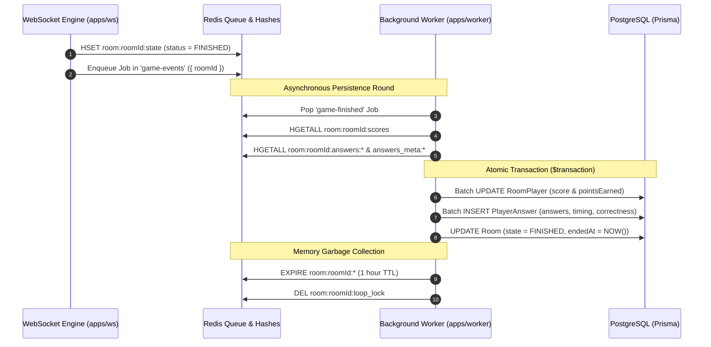

# 🛠️ QuizMaster Background Worker (`apps/worker`)

A dedicated BullMQ background worker service designed to consume asynchronous tasks from Redis, finalize multiplayer quiz game states, persist round history to PostgreSQL via Prisma, and perform memory garbage collection on ephemeral Redis keys.

---

## 🏗️ Architecture & Pipeline Overview

The WebSocket server (`apps/ws`) avoids writing to PostgreSQL during live gameplay to preserve sub-10ms latency. When the final question concludes, `GameEngine.finalizeGame()` enqueues a `game-finished` job into the BullMQ `game-events` queue.



---

## 📁 Directory Structure

```
apps/worker/
├── src/
│   ├── index.ts          # Process lifecycle & graceful shutdown handlers
│   ├── worker.ts         # BullMQ Worker instance & 'game-finished' processor
│   └── debug-room.ts     # CLI tool to inspect room keys & DB state
├── .env                  # DATABASE_URL and REDIS_URL
├── package.json
└── tsconfig.json
```

---

## ⚡ Actionable Implementation Plan

### Phase 1: Reliability, Atomicity & Observability (High Priority)
- [ ] **1. Comprehensive BullMQ Event Handlers**:
  - Attach `worker.on("failed", (job, err) => ...)` and `worker.on("completed", (job) => ...)`.
  - Log full diagnostic metadata on failure (Job ID, `roomId`, attempt count, and error stack) so silent failures never occur.
- [ ] **2. Atomic Database Writes with `prisma.$transaction`**:
  - Wrap the 3 database operations into a single transaction:
    1. Batch update `RoomPlayer` scores and points.
    2. Batch insert `PlayerAnswer` records with `skipDuplicates: true`.
    3. Update `Room` state to `FINISHED` with `endedAt = new Date()`.
  - Prevents partial writes if an error occurs mid-job before retrying.
- [ ] **3. Non-Blocking Key Cleanup**:
  - Replace `redisClient.keys('room:${roomId}:answers:*')` with a bounded index loop based on `roomQuestions.length` (`room:${roomId}:answers:${i}` and `room:${roomId}:answers_meta:${i}`).
  - Eliminates production latency spikes caused by blocking `KEYS` commands.

### Phase 2: Data Integrity & Dynamic Scoring (Medium Priority)
- [ ] **4. Dual Field Sync for `RoomPlayer`**:
  - Update both `score: finalScore` and `pointsEarned: finalScore` in `prisma.roomPlayer.updateMany`.
  - Keeps HTTP and Hono API read queries consistent.
- [ ] **5. Dynamic Question Point Values**:
  - Read `fullQuestion.points` and `fullQuestion.negativePoints` from the database instead of hardcoding `+4` and `-1`.
  - Record `0` points earned if player timed out without submitting.
- [ ] **6. Foreign Key Safety for Guest / Unregistered Users**:
  - Filter `userId` against existing database `User` records prior to `PlayerAnswer.createMany` to avoid `PlayerAnswer_userId_fkey` constraint errors.

### Phase 3: Additional Job Pipelines (Future Enhancements)
- [ ] **7. Game Abort / Room Cleanup Pipeline**:
  - Add support for a `"game-aborted"` job type to asynchronously release resources and archive abandoned rooms without blocking the WebSocket loop.
- [ ] **8. Post-Game Stats & Leaderboard Aggregation**:
  - Dispatch follow-up background tasks to update user player stats (total quizzes completed, wins, average response times, category rankings).

---

## 🚀 Running & Debugging

### Environment Configuration (`.env`)
```env
DATABASE_URL="postgresql://<user>:<password>@<host>/<database>?sslmode=require"
REDIS_URL="redis://default:<password>@<host>:<port>"
```

### Commands
```bash
# Start worker in watch mode (development)
npm run dev

# Type check worker code
npx tsc --noEmit

# Build production bundle
npm run build

# Inspect a specific room's Redis & DB state
npx tsx src/debug-room.ts <ROOM_ID_OR_CODE>
```
