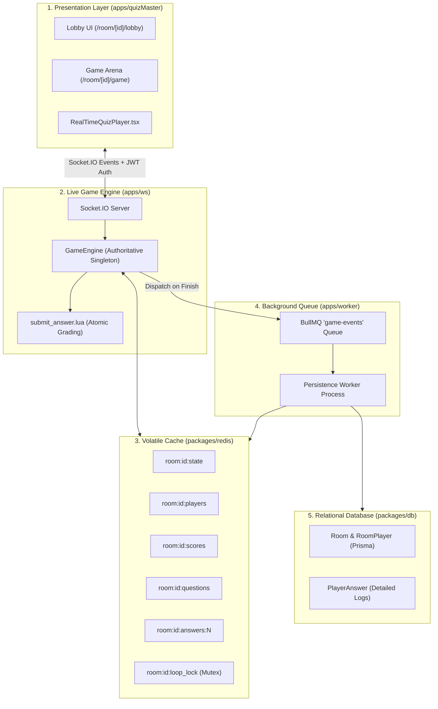
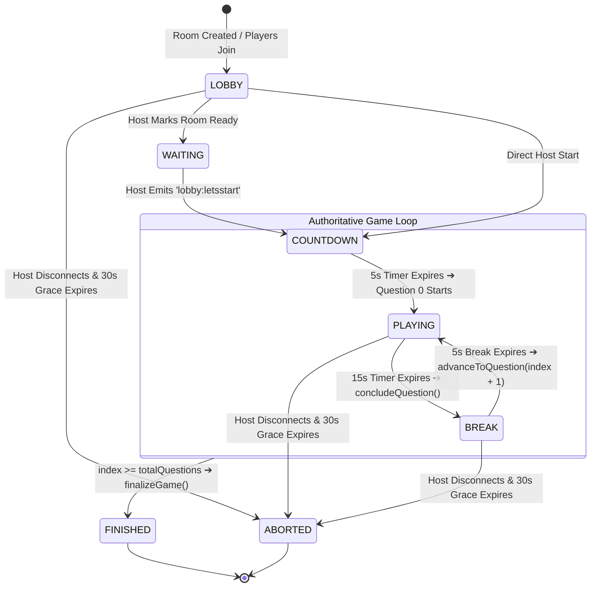

# 01. Multiplayer Architecture & Game Engine

QuizMaster Turbo operates on a **Server-Authoritative, Hybrid State Architecture**. The server is the absolute source of truth for all game events, question progression, scoring, and timers, while the Next.js frontend handles responsive rendering, optimistic button locking, and synchronized timer displays.

---

## 🏛 1. High-Level System Architecture

The monorepo separates concerns across 5 specialized tiers:



### Component Roles
1. **`apps/quizMaster` (Next.js Client)**: Connects via Socket.IO, manages JWT auth, handles client-side routing (`router.replace`), and computes millisecond countdowns relative to server timestamps.
2. **`apps/ws` (WebSocket Server)**: Runs the authoritative `GameEngine.ts` state machine, schedules node timeouts, sanitizes question payloads (hiding correct answers), and executes Redis Lua scripts.
3. **`packages/redis` (Redis In-Memory Store)**: Delivers sub-millisecond reads/writes for live scores, active player maps, randomized option order, and mutex locks.
4. **`apps/worker` (BullMQ Worker)**: Asynchronously consumes `game-finished` jobs to bulk-insert player answers into PostgreSQL and clean up Redis keys.
5. **`packages/db` (PostgreSQL / Prisma)**: Permanently stores historical user accounts, quizzes, rooms, and detailed question-by-question analytics.

---

## 🚦 2. Authoritative State Machine

The game strictly transitions through 6 operational states managed in `GameEngine.ts`:



### State Matrix

| State | Duration | Description | Permitted Client Actions |
| :--- | :--- | :--- | :--- |
| `LOBBY` | Indefinite | Room open for joining. Live roster broadcast. | `lobby:join`, `lobby:leave` |
| `WAITING` | Indefinite | Room prepared for start. | `lobby:join`, `lobby:leave`, `lobby:letsstart` (Host only) |
| `COUNTDOWN` | 5,000 ms | 5-second countdown. Clients navigate to `/game`. | `game:join` (reconnection/sync) |
| `PLAYING` | 15,000 ms | Active 15s question round. Timer counts down. | `game:submitAnswer` (1 attempt per question) |
| `BREAK` | 5,000 ms | 5-second break. Correct answer and Top 5 revealed. | View leaderboard (read-only) |
| `FINISHED` | Final | Game over. Full podium results shown. Persistence queued. | View final rank, navigate to `/result` |
| `ABORTED` | Final | Host dropped or room cancelled. All keys wiped. | Navigate to `/aborted` screen |

---

## ⏱ 3. Synchronized Timer Mechanism

### The Drift Problem
Relying on local client countdowns (`setInterval(15)`) creates desynchronization because players with slower network connections or laggy devices load pages 1–2 seconds later, giving them unfair extra time.

### The Shared Timestamp Solution
The server generates an absolute Unix timestamp when a question starts:
```typescript
// Server (GameEngine.ts)
const startTime = Date.now(); // e.g., 1707470000000
io.to(roomId).emit("game:questionStart", {
    question: clientQuestion,
    timeLimit: 15,
    startTime,
});
```

Every client calculates remaining time from the shared server `startTime`:
```typescript
// Client (RealTimeQuizPlayer.tsx)
useEffect(() => {
    const interval = setInterval(() => {
        const elapsed = (Date.now() - startTime) / 1000;
        const remaining = Math.max(0, Math.ceil(initialTimeLeft - elapsed));
        setLocalTimeLeft(remaining);
        if (remaining <= 0) clearInterval(interval);
    }, 100);
    return () => clearInterval(interval);
}, [startTime, initialTimeLeft]);
```
**Outcome**: Every connected player's screen reaches zero and locks at the exact same millisecond.

---

## 🛡 4. Fault Tolerance, Grace Periods & Crash Recovery

### A. Host 30-Second Grace Period (Lobby Only)
- **In Lobby Phase (`LOBBY`, `WAITING`)**: If the host drops connection before the game starts, a 30-second countdown timer starts (`hostGrace:${roomId}`) and emits 1-second ticks (`lobby:hostCountdown`) to warn lobby members with a live banner. If the host returns within 30s, the countdown cancels. If the host fails to return, the room is aborted and cleaned up.
- **During Active Gameplay (`COUNTDOWN`, `PLAYING`, `BREAK`)**: Host disconnection does **not** interrupt or abort the game. The game loop is server-authoritative, so all remaining players continue answering questions without interruption. The host is treated as a normal player who can reload/reconnect at any time.

### B. Player Reconnection & State Sync (`getSyncPayload`)
- If a player refreshes their browser or loses WiFi mid-game, their client emits `game:join` on reload.
- `GameEngine.getSyncPayload(roomId, userId)` inspects Redis and reconstructs:
  - Active game phase (`PLAYING`, `BREAK`, etc.)
  - Exact remaining milliseconds based on `questionStartTime`
  - Shuffled option ordering for the current question
  - Whether the user already submitted an answer (`HEXISTS`)
  - Current player score from `room:<roomId>:scores`
- The client receives `game:sync` and immediately restores their score, highlighted answer, and disabled button state.

### C. Server Crash Recovery (`recoverActiveRooms`)
- When the WebSocket server boots, `GameEngine.recoverActiveRooms()` scans Redis for all `room:*:state` keys.
- For each active room in `PLAYING` or `BREAK`, it computes elapsed time against `questionStartTime`.
- It concludes expired rounds immediately or re-arms in-memory timeouts for the remaining milliseconds, ensuring no game freezes after a server restart.
