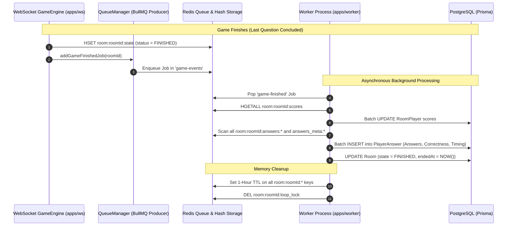

# 03. Asynchronous Persistence & Worker Pipeline

To guarantee sub-10ms response times during live multiplayer gameplay, the WebSocket server does **not** write to PostgreSQL during question rounds. Instead, all volatile state is finalized asynchronously via a **BullMQ Worker** once the quiz concludes.

---

## 🏗 1. Persistence Pipeline Overview



---

## 🛠 2. Background Worker Execution (`apps/worker/src/worker.ts`)

When a game ends, `GameEngine.finalizeGame()` enqueues a job into BullMQ queue `"game-events"`. The worker executes a 5-step transactional batch:

### Step 1: Read Final Scores
```typescript
const scores = await redisClient.hgetall(`room:${roomId}:scores`);
```

### Step 2: Batch Update `RoomPlayer` Records
```typescript
const updates = Object.entries(scores).map(async ([userId, score]) => {
    const finalScore = parseInt(score, 10);
    if (Number.isNaN(finalScore)) return;

    await prisma.roomPlayer.updateMany({
        where: { roomId: room.id, userId },
        data: { score: finalScore },
    });
});
await Promise.all(updates);
```

### Step 3: Collect and Map All `PlayerAnswer` Records
The worker pulls answers from every question index hash:
```typescript
for (const [index, rq] of roomQuestions.entries()) {
    const answersKey = `room:${roomId}:answers:${index}`;
    const answersMetaMap = await redisClient.hgetall(`room:${roomId}:answers_meta:${index}`);
    const answersMap = await redisClient.hgetall(answersKey);

    for (const [userId, selectedValue] of Object.entries(answersMap)) {
        const timeTaken = parseInt(answersMetaMap[userId] || "0", 10);
        const selectedOption = fullQuestion.Option.find(
            (o) => o.id === selectedValue || o.text === selectedValue,
        );
        const correctOption = fullQuestion.Option.find((o) => o.isCorrect);
        const isCorrect = selectedOption 
            ? selectedOption.isCorrect 
            : selectedValue === correctOption?.text;

        playerAnswersToCreate.push({
            roomId: room.id,
            roomQuestionId: rq.id,
            userId,
            selectedOptionId: selectedOption ? selectedOption.id : String(selectedValue),
            isCorrect,
            pointsEarned: isCorrect ? 4 : -1,
            responseTimeMs: timeTaken,
        });
    }
}

// Bulk insert all answers
await prisma.playerAnswer.createMany({
    data: playerAnswersToCreate,
    skipDuplicates: true,
});
```

### Step 4: Update PostgreSQL Room State
```typescript
await prisma.room.update({
    where: { id: room.id },
    data: { state: "FINISHED", endedAt: new Date() },
});
```

### Step 5: Clean Up Ephemeral Redis Keys
To free server memory while allowing players to view the post-game summary:
- `room:{roomId}:state` ➔ TTL set to 3600 seconds (1 hour).
- `room:{roomId}:questions` ➔ TTL set to 3600 seconds.
- `room:{roomId}:scores` ➔ TTL set to 3600 seconds.
- `room:{roomId}:answers:*` ➔ TTL set to 3600 seconds.
- Mutex lock `room:{roomId}:loop_lock` is deleted.

---

## 🗺 3. Source Code Reference Map

| Component / Layer | Key File Path |
| :--- | :--- |
| **Authoritative Game Engine** | [`apps/ws/src/core/GameEngine.ts`](file:///c:/Projects/quizMasterTurbo/apps/ws/src/core/GameEngine.ts) |
| **Atomic Grading Lua Script** | [`apps/ws/src/lua/submit_answer.lua`](file:///c:/Projects/quizMasterTurbo/apps/ws/src/lua/submit_answer.lua) |
| **Redis Connection & Helpers** | [`apps/ws/src/core/RedisManager.ts`](file:///c:/Projects/quizMasterTurbo/apps/ws/src/core/RedisManager.ts) |
| **BullMQ Queue Producer** | [`apps/ws/src/core/QueueManager.ts`](file:///c:/Projects/quizMasterTurbo/apps/ws/src/core/QueueManager.ts) |
| **BullMQ Persistence Worker** | [`apps/worker/src/worker.ts`](file:///c:/Projects/quizMasterTurbo/apps/worker/src/worker.ts) |
| **HTTP Room Controllers & Services** | [`apps/http/src/room/room.services.ts`](file:///c:/Projects/quizMasterTurbo/apps/http/src/room/room.services.ts) |
| **Frontend Lobby UI** | [`apps/quizMaster/app/room/[roomId]/lobby/page.tsx`](file:///c:/Projects/quizMasterTurbo/apps/quizMaster/app/room/%5BroomId%5D/lobby/page.tsx) |
| **Frontend Live Arena UI** | [`apps/quizMaster/app/room/[roomId]/game/page.tsx`](file:///c:/Projects/quizMasterTurbo/apps/quizMaster/app/room/%5BroomId%5D/game/page.tsx) |
| **RealTime Quiz Player Component** | [`apps/quizMaster/components/RealTimeQuizPlayer.tsx`](file:///c:/Projects/quizMasterTurbo/apps/quizMaster/components/RealTimeQuizPlayer.tsx) |
